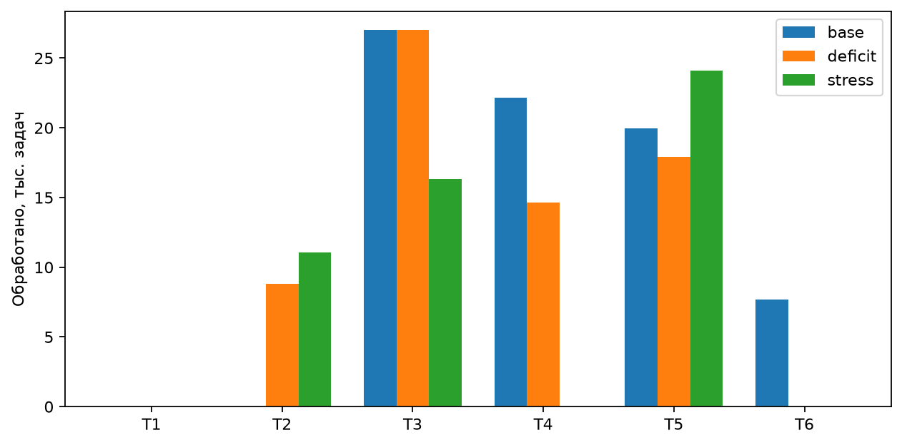

# Лабораторная работа 1
## Распределение ресурсов ЦОД

Мягкий Арсений Сергеевич. Дисциплина «Методы оптимизации». Группа 517. Порядковый номер N = 14, Q = 1, Y = 26. Вариант V = 1 + ((17·14 + 7·1 + 26) mod 20) = 12. Seed = 10000 + 100·1 + 14 = 10114.

Цель — максимизировать приоритетную обработку шести типов задач при четырёх ограниченных ресурсах. Базовый оптимум равен 1049.271676 условных единиц полезности. Активны ограничения CPU, RAM и IO; у NET остаётся резерв.

## Данные и формальная модель

Множества J = {T1,…,T6} — типы задач, R = {CPU, RAM, IO, NET} — ресурсы. Период планирования — одна смена. x_j ≥ 0 — обработанный объём, тыс. задач за смену; d_j — доступный спрос в тех же единицах. p_j — полезность обработки одной тысячи задач. a_rj — расход ресурса r на тысячу задач, b_r — запас за смену. CPU измеряется в ядро·ч, RAM — ГБ·ч, IO — тыс. операций, NET — ГБ.

max F = Σ_j p_j x_j

Σ_j a_rj x_j ≤ b_r для каждого r; 0 ≤ x_j ≤ d_j для каждого j.

| Тип | Спрос | Вес | CPU | RAM | IO | NET |
|---|---|---|---|---|---|---|
| T1 | 23 | 10 | 4 | 6 | 3 | 3 |
| T2 | 26 | 13 | 7 | 4 | 9 | 9 |
| T3 | 27 | 9 | 2 | 4 | 3 | 5 |
| T4 | 26 | 15 | 3 | 7 | 9 | 7 |
| T5 | 28 | 18 | 8 | 7 | 2 | 6 |
| T6 | 25 | 15 | 3 | 8 | 1 | 1 |

| Ресурс | Лимит | Расход | Запас | Теневая цена |
|---|---|---|---|---|
| CPU | 303 | 303 | 0 | 0.867052 |
| RAM | 464 | 464 | 0 | 1.52601 |
| IO | 328 | 328 | 0 | 0.190751 |
| NET | 447 | 417.445 | 29.5549 | 0 |

Данные синтетические: `default_rng(10114)` последовательно генерирует A целыми от 1 до 9, d от 16 до 30 и p от 5 до 20 включительно. Лимиты равны floor((A d)·α) покомпонентно, α = (0.43, 0.50, 0.47, 0.55). Процедура находится в `../generate_data.py`, готовые параметры — `data.json`.

Допущения: задачи делимы в масштабе тысячи, коэффициенты расхода постоянны, зависимости между задачами и обязательный минимум обслуживания отсутствуют. Очереди, задержки, пиковая нагрузка и переключение оборудования не моделируются.

## Реализация и проверка

Расчёт выполнен в Python через highspy и открытый решатель HiGHS. Версии зафиксированы в `../requirements.txt` и `../environment.json`. LP решается симплекс-методом, presolve включён; в отдельном бенчмарке используется также IPM. Один поток, random_seed = 10114, предел времени 60 с; допуски допустимости и целочисленности решателя 1e-8. Для MILP заданы mip_rel_gap = 0 и mip_abs_gap = 0.

Статус Optimal означает найденный оптимум в пределах численных допусков. Infeasible означает отсутствие допустимого плана; Unbounded — неограниченную цель, что потребовало бы проверки пропущенных границ. При Time limit допустимый найденный план нельзя называть доказанно оптимальным: нужно указать лучшую границу и текущий gap. В приведённых экспериментах все основные задачи получили Optimal.

Независимые функции `verify` работают с NumPy и исходными данными, не обращаются к объекту HiGHS, отдельно пересчитывают ограничения и цель. Порог проверки всех ограничений — 1e-7. Неокруглённые решения хранятся в CSV и JSON; округление в отчёте служит только для чтения.

HiGHS минимизирует −pᵀx; в отчёте знак возвращён к максимизации. Максимальное нарушение по трём сценариям — 0, максимальная ошибка пересчёта цели — 0. `results/verification.json` содержит расход и запас каждого ресурса, нижние и верхние запасы каждой переменной. Контрольные ошибочные планы с отрицательным объёмом и превышением лимитов отклонены.

## Найденный план и сценарии

| Тип | base | deficit | stress |
|---|---|---|---|
| T1 | 0 | 0 | 0 |
| T2 | 0 | 8.81929 | 11.0601 |
| T3 | 27 | 27 | 16.3457 |
| T4 | 22.1619 | 14.6437 | 0 |
| T5 | 19.9422 | 17.9168 | 24.111 |
| T6 | 7.65896 | 0 | 0 |

Базовый сценарий использует исходные лимиты. Дефицитный уменьшает RAM на 20%. Стрессовый уменьшает этот ресурс на 40% относительно базы и одновременно IO на 40%.

| Сценарий | Цель | Прогноз цен | Ошибка прогноза |
|---|---|---|---|
| base | 1049.27 | 1049.27 | 0 |
| deficit | 899.807 | 907.658 | -7.8507 |
| stress | 724.89 | 741.017 | -16.1272 |

При дефиците RAM T6 исключается, а часть ресурса переходит к T2; в стрессовом плане остаются T2, T3 и T5. Нулевые переменные возникают потому, что приоритет оценивается вместе с расходом дефицитных ресурсов, а не сам по себе. Для нулевых переменных базового плана: T1: ценность 10, ресурсная оценка 13.196532; T2: ценность 13, ресурсная оценка 13.890173. Их включение при текущих ценах ресурсов уменьшило бы общую полезность. В модели это допустимо, но для обязательных сервисов понадобятся нижние границы обслуживания.

## Теневые цены

Цена λ_r = −row_dual_r для задачи минимизации −F показывает прирост F при добавлении одной единицы ресурса r в окрестности текущего базиса. По исходной шкале наибольшая цена у RAM: 1.526012 на ГБ·ч; затем CPU 0.867052 на ядро·ч и IO 0.190751 на тыс. операций. NET имеет нулевую цену, поэтому его небольшое увеличение не улучшает план. Ресурсы имеют разные единицы: для реальной закупки следует сравнивать λ_r с ценой единицы ресурса. Рекомендация сначала увеличить RAM относится к принятой нормировке затрат.

| resource | delta | predicted_gain | actual_gain |
|---|---|---|---|
| CPU | 0.01 | 0.00867052 | 0.00867052 |
| RAM | 0.01 | 0.0152601 | 0.0152601 |
| IO | 0.01 | 0.00190751 | 0.00190751 |
| NET | 0.01 | 0 | 0 |

При прибавке 0.01 единицы каждого ресурса локальный прогноз совпадает с фактическим изменением цели. При сокращении RAM на 20% прогноз уже завышает полезность на 7.850697; при стрессовом сокращении — на 16.127168. Причина — смена оптимального базиса и самих теневых цен; исходные цены не являются глобальным линейным прогнозом.

## Вывод

При исходных запасах выгодно полностью обработать T3 и частично T4–T6. План реализуем как агрегированная квота на смену, если нагрузка достаточно дробная. Для внедрения нужны гарантии минимального обслуживания, ограничения задержек и запас мощности; округлять полученный план до отдельных задач без повторной проверки нельзя.

Расширение со звёздочкой приведено в `STAR_BENCHMARK.md`. Полные планы, сценарии, проверки и журналы находятся в `results/`.

Методическая основа — предоставленный комплекс лабораторных работ А. А. Кузьмина, 2026, вариант 12. Интерфейс решателя: [официальные примеры highspy](https://ergo-code.github.io/HiGHS/dev/interfaces/python/example-py/); параметры и допуски: [документация HiGHS](https://ergo-code.github.io/HiGHS/dev/options/definitions/).
