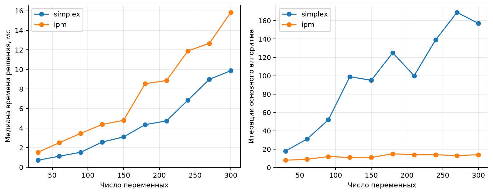

# Сравнение симплекс метода и метода внутренней точки

Задание со звёздочкой 1. Мягкий Арсений Сергеевич. Дисциплина «Методы оптимизации». Группа 517. Порядковый номер N = 14, Q = 1, Y = 26. Вариант V = 1 + ((17·14 + 7·1 + 26) mod 20) = 12. Seed = 10000 + 100·1 + 14 = 10114.

## Цель и воспроизводимая процедура

Сравниваются два алгоритма HiGHS на десяти различных ограниченных LP растущего размера. Для k = 1,…,10 берутся n = 30k переменных и m = 15k ресурсных ограничений. Модель: min cᵀx, Ax ≤ b, 0 ≤ x ≤ u. Вызовы RNG выполняются последовательно из default_rng(10214). Каждый коэффициент A сначала равномерно выбирается из [0.05, 1), затем обнуляется с вероятностью 0.75. u_j выбираются из [5, 15), c_j — из (−10, −1], b_i = (Au)_i α_i, α_i из [0.25, 0.55). Нулевой план допустим, конечные верхние границы гарантируют ограниченность.

Все десять конкретных наборов сохранены в `benchmark_data.json`; генерация и расчёт реализованы функцией `benchmark` в `run.py`. Это дополнительные тесты алгоритмов, они не заменяют индивидуальную модель ЦОД минимального размера.

Для каждого набора запускаются solver=simplex и solver=ipm. Presolve включён одинаково, используется один поток. Каждый запуск получает новый объект HiGHS без ранее найденного базиса. Измеряется только `h.run()` через perf_counter: загрузка библиотек и построение матрицы не входят во время, presolve и работа с журналом входят. Выполняются три запуска каждого метода, в таблице указана медиана. Начальный запуск приложения может включать прогрев; поэтому результаты относятся к данной серии, а не к абсолютной скорости процессора. Полные журналы всех 60 запусков сохранены в `results/logs/benchmark_*`.

После каждого запуска независимо проверяются все границы, Ax ≤ b и cᵀx с допуском 1e-7. Требуется Optimal; значения целей двух методов сопоставляются для каждого экземпляра. Проверка выполняется до записи итоговой таблицы, поэтому недопустимый или неоконченный расчёт прервал бы выполнение.

## Результаты

| n | m | Simplex мс | IPM мс | Simplex ит. | IPM ит. | Разность целей |
|---|---|---|---|---|---|---|
| 30 | 15 | 0.7134 | 1.522 | 18 | 8 | 0 |
| 60 | 30 | 1.1241 | 2.508 | 31 | 9 | 4.54747e-13 |
| 90 | 45 | 1.5254 | 3.4611 | 52 | 12 | 4.54747e-13 |
| 120 | 60 | 2.5737 | 4.3714 | 99 | 11 | 1.36424e-12 |
| 150 | 75 | 3.0983 | 4.7994 | 95 | 11 | 7.27596e-11 |
| 180 | 90 | 4.3462 | 8.5373 | 125 | 15 | 1.54614e-11 |
| 210 | 105 | 4.7384 | 8.8611 | 100 | 14 | 9.09495e-13 |
| 240 | 120 | 6.8518 | 11.8938 | 139 | 14 | 1.30058e-10 |
| 270 | 135 | 8.9849 | 12.6608 | 169 | 13 | 7.27596e-12 |
| 300 | 150 | 9.8696 | 15.8358 | 157 | 14 | 1.00044e-11 |

В этой серии симплекс быстрее в 10 из 10 задач. На максимальном размере медианы составили 9.870 и 15.836 мс соответственно. Максимальное расхождение оптимальных целей — 1.3e-10, что меньше 1e-7. Оба метода дают одинаковый оптимум с точностью проверки; найденные векторы могут различаться при альтернативных оптимумах.

IPM использует меньше основных итераций, но одна итерация включает более дорогую работу с системой линейных уравнений. Число итераций разных методов не является единой мерой трудоёмкости. Отдельный столбец crossover_iterations в `results/benchmark.csv` учитывает переход от решения внутренней точки к базисному решению, если он выполнялся.

## Интерпретация и ограничения сравнения

Для небольших ресурсных задач этой серии выбор симплекс-метода оправдан измерениями. Однако десять задач одного семейства и три повтора не доказывают его превосходства на любых LP: плотность матриц, масштаб коэффициентов и геометрия ограничений могут изменить результат. На малых временах влияние файлового журнала и нагрузки компьютера заметно; повторный запуск сохраняет данные и оптимумы, но может изменить миллисекунды.

Рост числа переменных не обязан давать строго монотонную кривую времени: меняются случайная структура и работа presolve. Все сравнения произведены при одинаковых настройках и на одинаковом входе для двух алгоритмов. Итоговый выбор для основной ЛР — simplex; IPM остаётся рабочей альтернативой для других размеров и структур.
