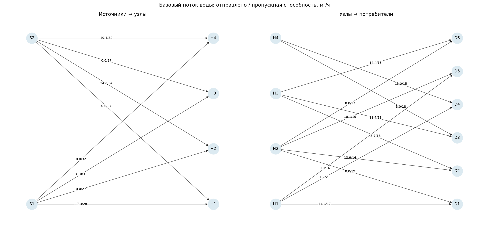

# Лабораторная работа 2
## Доставка воды с потерями в сети

Мягкий Арсений Сергеевич. Дисциплина «Методы оптимизации». Группа 517. Порядковый номер N = 14, Q = 1, Y = 26. Вариант V = 1 + ((17·14 + 7·1 + 26) mod 20) = 12. Seed = 10000 + 100·1 + 14 = 10114.

В сети из 12 вершин и 20 дуг требуется удовлетворить спрос с минимальными затратами на перекачку. В базовом плане стоимость равна 529.370767 ден. ед./ч, потребителям доставляется 90 м³/ч. Потери составляют 11.462195 м³/ч и компенсируются подачей из источников.

## Сеть и исходные данные

S = {S1,S2} — источники, H = {H1,…,H4} — промежуточные узлы, D = {D1,…,D6} — потребители; V = S ∪ H ∪ D. E содержит восемь дуг от каждого источника к каждому узлу H и двенадцать дуг от H к D. У каждого потребителя два входящих маршрута. Источники могут подавать не более 65 м³/ч каждый, фактическая подача выбирается моделью.

| Потребитель | Спрос м³/ч |
|---|---|
| D1 | 14 |
| D2 | 16 |
| D3 | 14 |
| D4 | 16 |
| D5 | 17 |
| D6 | 13 |

| Дуга | u | η | c | f |
|---|---|---|---|---|
| S1→H1 | 28 | 0.94 | 4 | 17.325 |
| S1→H2 | 27 | 0.94 | 4 | 0 |
| S1→H3 | 31 | 0.96 | 2 | 31 |
| S1→H4 | 32 | 0.98 | 4 | 0 |
| S2→H1 | 27 | 0.94 | 4 | 0 |
| S2→H2 | 34 | 0.94 | 1 | 34 |
| S2→H3 | 27 | 0.96 | 4 | 0 |
| S2→H4 | 32 | 0.94 | 3 | 19.1372 |
| H1→D1 | 17 | 0.96 | 4 | 14.5833 |
| H2→D1 | 19 | 0.94 | 5 | 0 |
| H2→D2 | 16 | 0.9 | 3 | 13.8749 |
| H3→D2 | 18 | 0.96 | 5 | 3.65895 |
| H3→D3 | 19 | 0.96 | 3 | 11.6566 |
| H4→D3 | 18 | 0.94 | 2 | 2.989 |
| H4→D4 | 15 | 0.96 | 3 | 15 |
| H1→D4 | 21 | 0.94 | 5 | 1.70213 |
| H1→D5 | 14 | 0.94 | 4 | 0 |
| H2→D5 | 19 | 0.94 | 2 | 18.0851 |
| H2→D6 | 17 | 0.96 | 5 | 0 |
| H3→D6 | 18 | 0.9 | 4 | 14.4444 |

Здесь u — пропускная способность по отправляемому объёму, м³/ч; η — безразмерная доля дошедшей воды; c — стоимость отправки одного м³, ден. ед./м³; f — оптимальный отправляемый поток, м³/ч. На конце дуги прибывает ηf, а не f. Перекачка на каждом следующем участке оплачивается отдельно.

Синтетические данные получены default_rng(10114). В порядке «источник, узел» генерируются u от 24 до 35, c от 1 до 4, η из {0.94,0.96,0.98}. Затем для потребителя с индексом d от 0 до 5 выбираются узлы d mod 4 и (d+1) mod 4, генерируются u от 13 до 21, c от 1 до 5, η из {0.90,0.94,0.96}. Последними генерируются шесть спросов от 13 до 17 включительно. Данные — `data.json`, процедура — `../generate_data.py`.

## Линейная модель

Переменные f_e ≥ 0 — отправленный поток, s_v ≥ 0 — подача источника. Для остальных вершин s_v = 0. d_v — спрос вершины; у источников и промежуточных узлов он нулевой.

min C = Σ_(e∈E) c_e f_e

s_v + Σ_(e входит в v) η_e f_e − Σ_(e выходит из v) f_e = d_v для каждого v ∈ V.

0 ≤ f_e ≤ u_e; 0 ≤ s_S1 ≤ 65; 0 ≤ s_S2 ≤ 65.

Это обобщённый поток с потерями. Матрица содержит η ≠ 1, поэтому свойство целочисленности обычной транспортной задачи здесь не используется. Потоки непрерывны. Предполагаются постоянные доли потерь и удельные тарифы; не учитываются давление, нелинейная гидравлика, резервуары и динамика спроса.

## Реализация и независимая проверка

Расчёт выполнен в Python через highspy и открытый решатель HiGHS. Версии зафиксированы в `../requirements.txt` и `../environment.json`. LP решается симплекс-методом, presolve включён; в отдельном бенчмарке используется также IPM. Один поток, random_seed = 10114, предел времени 60 с; допуски допустимости и целочисленности решателя 1e-8. Для MILP заданы mip_rel_gap = 0 и mip_abs_gap = 0.

Статус Optimal означает найденный оптимум в пределах численных допусков. Infeasible означает отсутствие допустимого плана; Unbounded — неограниченную цель, что потребовало бы проверки пропущенных границ. При Time limit допустимый найденный план нельзя называть доказанно оптимальным: нужно указать лучшую границу и текущий gap. В приведённых экспериментах все основные задачи получили Optimal.

Независимые функции `verify` работают с NumPy и исходными данными, не обращаются к объекту HiGHS, отдельно пересчитывают ограничения и цель. Порог проверки всех ограничений — 1e-7. Неокруглённые решения хранятся в CSV и JSON; округление в отчёте служит только для чтения.

Модель содержит 22 переменные: 20 потоков и 2 подачи; 12 балансовых равенств плюс границы. Функция verify независимо обходит дуги и для каждой вершины складывает фактические притоки и оттоки с потерями. Проверяются все 20 ёмкостей и обе подачи. На четырёх сценариях максимальная невязка/нарушение составляет 3.55e-15. В базе подача 101.462195 = доставка 90.000000 + потери 11.462195 м³/ч.

Остатки балансов по каждой вершине сохранены в `results/node_balances.csv`, запасы каждой дуги и источника — в `results/verification.json`. Пересчёт цели совпал с решателем с точностью 1e-7. Изменение одного потока на 1 м³/ч контрольная проверка отклоняет.

На схеме одна сеть разделена на два слоя для читаемости. На каждой дуге подписаны отправляемый поток и ёмкость; общие H1–H4 соединяют слои. Тарифы и потери указаны в таблице выше.

## Сценарии и узкие места

base — исходные параметры. deficit — спрос каждого потребителя увеличен на 20%. stress — отказ наиболее загруженной дуги S2→H2; наиболее загруженная определяется по максимальному абсолютному потоку, здесь 34 м³/ч. overload — её ёмкость сокращена на 20%, чтобы исследовать перегрузку отдельно от полного отказа.

| scenario | status | cost | cost_change |
|---|---|---|---|
| base | Optimal | 529.371 | 0 |
| deficit | Optimal | 671.01 | 141.639 |
| stress | Optimal | 626.276 | 96.9054 |
| overload | Optimal | 547.152 | 17.7809 |

Во всех сценариях спрос обеспечен полностью. Рост спроса повышает затраты на 141.639175, закрытие дуги — на 96.905360 ден. ед./ч. Отказ не разрывает сеть: остаются обходные пути, однако их использование дороже. При сужении дуги ущерб меньше: 17.780915. План каждого сценария сохранён по всем дугам в `results/solution.csv`; соответствующие изменённые данные — в `results/scenario_data.json`.

| arc | flow | capacity | capacity_value |
|---|---|---|---|
| S1-H3 | 31 | 31 | 0.209869 |
| S2-H2 | 34 | 34 | 2.61484 |
| H4-D4 | 15 | 15 | 3.26075 |

Эти дуги насыщены. Для активной верхней границы capacity_value = −col_dual показывает локальное снижение затрат при увеличении пропускной способности на 1 м³/ч. Наибольшую ценность имеет H4→D4: 3.260751 ден. ед. на дополнительную единицу ёмкости. Она не совпадает с дугой максимального абсолютного потока: физическая загрузка и экономическая ценность расширения — разные характеристики. Цены действуют локально, до изменения базиса.

## Сравнение с жадной эвристикой

Все двухзвенные пути S→H→D сортируются по стоимости одного доставленного м³: c_SH/(η_SH η_HD) + c_HD/η_HD. По порядку на путь направляется максимально возможный объём с учётом остаточного спроса, обеих дуг и источника. Это самостоятельный алгоритм без вызовов решателя. Для данного входа он допустим и полностью удовлетворяет спрос; для других входов такой алгоритм может остановиться с дефицитом, даже когда LP допустима.

Стоимость эвристики 531.983994, оптимум 529.370767; зазор (C_g−C*)/C* = 0.493648%. Время эвристики 0.116 мс, решения LP 0.707 мс. Это единичные измерения без построения LP и без записи результатов; для HiGHS включена запись журнала. Малое время не является устойчивой характеристикой производительности. Проверка эвристики сохранена отдельно.

## Вывод

При заданных потерях воды и ёмкостях сеть выдерживает увеличение спроса на 20% и отказ выбранной дуги. Наиболее полезное локальное расширение — H4→D4. Полученный стационарный план можно использовать как плановый расход, но перед практической реализацией требуется гидравлическая проверка давления и насосов; LP сама по себе её не заменяет.

Методическая основа — предоставленный комплекс лабораторных работ А. А. Кузьмина, 2026, вариант 12. Интерфейс решателя: [официальные примеры highspy](https://ergo-code.github.io/HiGHS/dev/interfaces/python/example-py/); параметры и допуски: [документация HiGHS](https://ergo-code.github.io/HiGHS/dev/options/definitions/).
